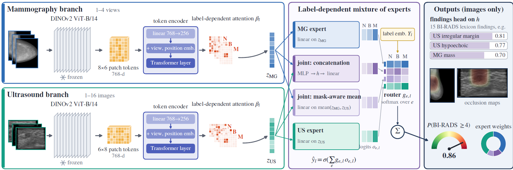

# LS-MoE: language-supervised multimodal experts for BI-RADS assessment

LS-MoE predicts a BI-RADS ≥4 assessment, i.e. a biopsy recommendation, from paired mammography (MG) and ultrasound (US). A label-dependent router weighs MG, US and joint experts for each patient. The radiology report is used only during training: a cross-fitted report teacher gives soft labels, the report's MG and US sections give routing targets, and a local LLM (Qwen2.5-7B-Instruct) turns each masked report into 15 BI-RADS lexicon findings. At test time the model needs only the images and returns the risk, the expert weights, the predicted findings and occlusion maps.



## Data

The code uses the public BCMID dataset ([Zenodo](https://doi.org/10.5281/zenodo.19402690)). Place the notebook next to the data folder, or set `DATA_DIR` in the settings cell:

```
project/
├── ls_moe_bcmid.ipynb
└── Breast Cancer Project/
    ├── BCMID_annotations.tsv
    └── 0103y17/
        ├── Mammogram/
        ├── Ultrasound/
        └── 0103y17_US_MG_Report.pdf
```


## License

Code: MIT. BCMID is distributed by its authors under CC BY 4.0.
